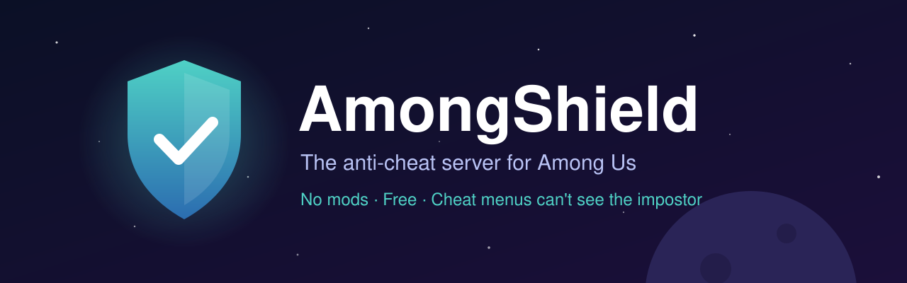

<p align="center">
  
</p>

<p align="center">
  
  
  
  
  <a href="https://www.virustotal.com/gui/file/980d659a34a2794d8929b454e98b7e7cc36ddaaafe9916a0e7618b2429f26c9f"></a>
</p>

<p align="center">
  A free community server for <b>Among Us</b> where cheat menus can't see who the impostor is,<br>
  and cheaters get kicked and called out in chat.<br><br>
  You play the normal game. You just pick the <b>AmongShield</b> region instead of North America, Europe or Asia.<br><br>
  <a href="https://amongshieldserver.github.io/AmongShield/"><b>👉 Quick setup page (PC and phone)</b></a>
</p>

---

## ✨ What it does

### 🛡️ ESP protection
Cheat menus that show roles are fed fake impostors. Every cheater sees several impostors and can't tell which ones are real. Honest players see nothing different.

<p align="center"></p>

### 🚨 Cheaters get caught
The server watches every game for things that aren't possible without cheats. Cheaters get stopped, kicked from the lobby, and everyone in the lobby gets a chat message saying who it was.

### 📋 Game result note
After each game, the lobby chat shows who the impostors really were.

### 🔦 Custom vision for hosts
In the lobby, the host can type:

| Command | What it does |
|---|---|
| `/vision crew 0.85` | Set crewmate vision (any value from 0.05 to 5) |
| `/vision imp 1.6` | Set impostor vision |
| `/vision crew up` or `/vision crew down` | Change it in 0.05 steps |
| `/vision` | Show the current values |
| `/vision reset` | Go back to the normal menu values |

---

## 🚀 How to join

> **Everyone in a lobby needs the AmongShield region, the host and all players.**

### 💻 PC (Steam, Epic, Microsoft Store): easy way

1. **Close Among Us.**
2. Download [`Add-AmongShield.ps1`](Add-AmongShield.ps1) (open it, then click the download button ⤓).
3. Right-click the file and choose **Run with PowerShell**. If Windows asks whether to run it, choose **Run once** or **Open**.
4. Start Among Us. The **AmongShield** region is already selected. Create or join a game as usual.

The script only edits Among Us's server list and saves a backup of it first (`regionInfo.json.backup`). It's about 20 lines, so feel free to read it before running it.

### 🛠️ PC: do it yourself (no script)

<details>
<summary>Click to show the steps</summary>

1. **Close Among Us.**
2. Press `Win + R`, paste this and press Enter:
   ```
   notepad "%USERPROFILE%\AppData\LocalLow\Innersloth\Among Us\regionInfo.json"
   ```
3. The file is one long line. Find `"Regions":[` and paste the text from [`region-entry.json`](region-entry.json) right after the `[`, followed by a comma `,`. It should look like this:
   ```
   "Regions":[{ ...AmongShield entry... },{ ...the regions that were already there... }]
   ```
4. Save and close Notepad, then start Among Us and pick **AmongShield** in the region menu (the globe button on the main menu).

If the game won't load the regions afterwards, a comma or bracket is missing. Delete `regionInfo.json` and Among Us will rebuild the default one.

</details>

### 📱 Phone (Android, iPhone)

1. **Open Among Us** and wait for the main menu. Leave it running.
2. On your phone, open **[amongshieldserver.github.io/AmongShield](https://amongshieldserver.github.io/AmongShield/)** and tap **Add AmongShield to Among Us**.
3. Back in Among Us, tap the **region button** (globe, bottom right) and pick **AmongShield**.

Not in the list? Tap the button again while the game is running. If the Play Store opens, install Among Us first.

### ↩️ Going back to normal servers

Pick **North America**, **Europe** or **Asia** in the region menu. AmongShield stays in the list for next time.

---

## ❓ FAQ

**Is the PC script safe?**
It's about 20 lines of plain text that only edits Among Us's server list (`regionInfo.json`) and saves a backup first. Open it in Notepad and read it before running, or skip it and follow the manual steps instead. It's also been [scanned on VirusTotal](https://www.virustotal.com/gui/file/980d659a34a2794d8929b454e98b7e7cc36ddaaafe9916a0e7618b2429f26c9f): 0 of 60 antivirus engines flagged it.

**Is this a mod? Can it get my account in trouble?**
It's not a mod. Nothing in the game is changed. Among Us has a built-in option for custom servers (regions), and that's all this uses. Your game files stay untouched.

**What does the server know about me?**
What any Among Us server sees: your in-game name, your platform (PC, phone, etc.) and your IP address. It never sees your password or account login. Server logs are deleted automatically after 14 days and are only used to fix bugs and deal with cheaters.

**Who runs this?**
It's a small community project, run for free. No ads, no payments, no data selling.

**How do I stop using it?**
Pick North America, Europe or Asia in the region menu. To remove AmongShield completely on PC, restore `regionInfo.json.backup` (rename it to `regionInfo.json`).

---

## 💡 Good to know

- Only games on the AmongShield region are protected. Official servers work like before.
- The shield hides **roles**, not positions. A cheater can still see where people are, but not who the impostor is.
- 👻 **Ghosts:** after you die, haunting a player may show the wrong role. That's the shield doing its job. The game result note after each game always shows who the impostors really were.
- This is a small free server. If it's full or down, try again later.
- Found a bug or got kicked by mistake? Open an [issue](../../issues) and say what happened and roughly when.

## 🙏 Credits

AmongShield runs on a modified version of [Impostor](https://github.com/Impostor/Impostor), the open-source Among Us server (GPL-3.0). Thanks to the Impostor team for making private servers possible.

<sub>Not affiliated with Innersloth. Among Us is a trademark of Innersloth LLC.</sub>
