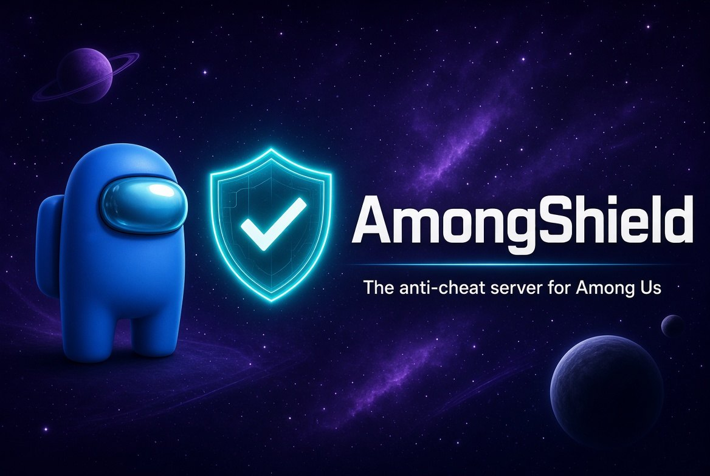
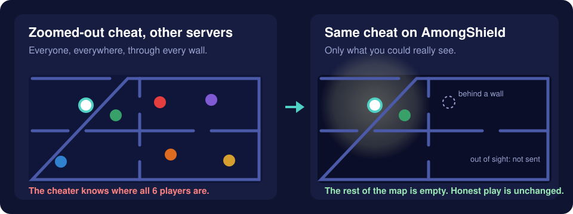
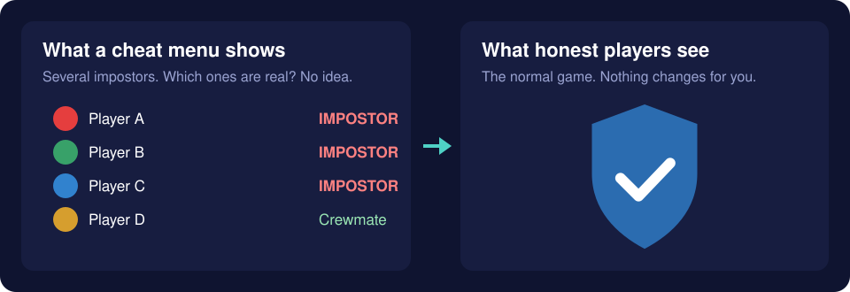

<p align="center">
  
</p>

<p align="center">
  
  
  
  
  
  <a href="https://www.virustotal.com/gui/file/eff11ee4d9e553b369aa2b47f783736d15b054c46d8559591e5f5ab33fdb545c"></a>
</p>

<p align="center">
  A free community server for <b>Among Us</b> where cheat menus can't see who the impostor is,<br>
  <b>can't zoom out or see through walls</b>, and cheaters get kicked and called out in chat.<br><br>
  You play the normal game. You just pick the <b>AmongShield</b> region instead of North America, Europe or Asia.<br>
  Works on <b>PC, Mac, Android and iPhone</b>.<br><br>
  <a href="https://amongshieldserver.github.io/AmongShield/"><b>👉 Quick setup page (PC, Mac, Android, iPhone)</b></a>
</p>

---

## ✨ What it does

### 🌫️ Anti-zoom fog <sup>NEW</sup>
**Zoom hacks and wallhacks see an empty map.**

Most anti-cheats try to catch a cheater after the damage is done. AmongShield makes sure the information never reaches the cheater in the first place: the server only sends your game the positions of players **you could actually see**, inside your vision and not hidden behind a wall.

<p align="center"></p>

- **Stops zoom-out, see-through-walls and player radar** from cheat menus like MalumMenu. There's nothing to show them.
- **Honest players see nothing different.** People step out of the shadows exactly like they always do.
- **Admin, cameras, binoculars, Tracker and Detective** still work: whoever is using them gets everyone's real position.
- **On in every lobby.** The host can turn it off:

| Command | What it does |
|---|---|
| `/fog off` | Turn the fog off for this lobby (host only, in the lobby) |
| `/fog on` | Turn it back on |
| `/fog` | Show whether it's on |

AmongShield is the only Among Us anti-cheat that can do this right now.
### 🛡️ ESP protection
Cheat menus that show roles are fed fake impostors. Every cheater sees several impostors and can't tell which ones are real. Honest players see nothing different.

<p align="center"></p>

### 🚨 Cheaters get caught
The server watches every game for things that aren't possible without cheats. Cheaters get stopped, kicked from the lobby, and everyone in the lobby gets a chat message saying who it was.

Kicked on sight:
- Forcing sabotages as a crewmate
- Fixing sabotages, reporting bodies or pressing the button as a ghost
- Faking a Medbay scan as the impostor
- Venting without a role that can vent
- Using cameras away from Security
- Making the lights unfixable
- Long-range kills and instant tasks

Identified and reported: the cheat is blocked and the lobby is told who's suspected of cheating:
- Speed hacks and teleports
- Moving or killing during a meeting
- Calling meetings from across the map, past the button limit or before the cooldown
- Reporting bodies from far away
- Engineer vent cheats (endless vent time, no cooldown)
- Fixing sabotages from across the map or from inside a vent
- Kicking everyone out of vents
- Chatting while alive outside a meeting

### 📋 Game result note
After each game, the lobby chat shows who the impostors really were.

### 🔦 Custom vision for hosts
In the lobby, the host can type:

| Command | What it does |
|---|---|
| `/vision crew 0.85` | Set crewmate vision (any value from 0.05 to 5) |
| `/vision imp 1.6` | Set impostor vision |
| `/vision crew up` or `/vision crew down` | Change it in 0.05 steps |
| `/vision` | Show the current values |
| `/vision reset` | Go back to the normal menu values |

### 🔄 Host rotation
After each game, the host role passes to the next player, so nobody is stuck hosting all night. It's **on** in public lobbies and **off** in private ones.

| Command | What it does |
|---|---|
| `/rotate on` | Turn host rotation on (host only, in the lobby) |
| `/rotate off` | Turn it off |
| `/rotate` | Show whether it's on |

If the new host doesn't come back from the end screen within 20 seconds, the next waiting player becomes host, so nobody gets stuck.

---

## 🚀 How to join

> **Everyone in a lobby needs the AmongShield region, the host and all players.**

### 💻 PC (Steam, Epic, itch.io, Microsoft Store / Xbox app): easy way

1. **Close Among Us.**
2. Open **PowerShell**: press the Start key, type `PowerShell`, press Enter.
3. Paste this line and press Enter:
   ```
   irm https://amongshieldserver.github.io/AmongShield/Add-AmongShield.ps1 | iex
   ```
4. When it says **Server successfully added!**, start Among Us. The **AmongShield** region is already selected. Create or join a game as usual.

That line fetches the setup script, [`Add-AmongShield.ps1`](Add-AmongShield.ps1), from the setup page and runs it right away, without saving a file. It works with every PC version: Steam, Epic Games, itch.io and the Microsoft Store / Xbox app. The script only edits Among Us's server list and saves a backup of it first (in `%LOCALAPPDATA%\AmongShield-backup`). If anything goes wrong, a message tells you what to do. It's about 60 lines, so feel free to read it first.

**Prefer to download it and read it first?** Download [`Add-AmongShield.ps1`](Add-AmongShield.ps1), then in PowerShell type `powershell -ExecutionPolicy Bypass -File ` (with a space at the end), drag the downloaded file into the window and press Enter. (Double-clicking or *Run with PowerShell* won't work: Windows blocks downloaded scripts that way.)

#### 🩹 Script not working?

- **The window flashes and closes, or it says "running scripts is disabled" / "not digitally signed":** Windows blocks downloaded scripts when you double-click or use *Run with PowerShell*. Use the line from step 3 instead.
- **"Cannot find path" or "does not exist"** (downloaded-file method): type `powershell -ExecutionPolicy Bypass -File ` (with a space at the end), then **drag the downloaded file into the PowerShell window** to paste its exact location, and press Enter. Or just use the line from step 3, which needs no file.
- **"Among Us is still open":** close the game completely. Check the taskbar and the hidden icons next to the clock, or end **Among Us** in Task Manager (Ctrl + Shift + Esc).
- **The line from step 3 shows a red error about the connection:** check your internet, or use the downloaded file or the no-script option below.
- **The browser or antivirus deleted or blocked the download:** choose **Keep** in the browser's download list, use the line from step 3 (no download needed), or use the no-script option below.
- **"Server list wasn't found":** start Among Us once, wait for the main menu, close it, and run the line again.
- **Something else?** The pop-up says what went wrong. Open an [issue](../../issues) and say what it says.

### 📄 PC: no-script option

Don't want to run a script? Download a ready-made server list and put it in the game's folder.

1. **Close Among Us.**
2. Download [`regionInfo.json`](regionInfo.json) (open it, then click the download button ⤓).
3. Press `Win + R`, paste this and press Enter (the game's folder opens):
   ```
   %USERPROFILE%\AppData\LocalLow\Innersloth\Among Us
   ```
4. Drag the downloaded file into that folder and choose **Replace**. It must be named exactly `regionInfo.json` (rename it if it says `regionInfo (1).json`).
5. Start Among Us. **AmongShield** is already selected.

**Note:** this replaces your server list with North America, Europe, Asia and AmongShield. If you use other private servers, use the script instead so they're kept. Works with Steam, Epic and itch.io (not the Microsoft Store / Xbox app version).

### 🛠️ PC: do it yourself (no script)

<details>
<summary>Click to show the steps</summary>

1. **Close Among Us.**
2. Press `Win + R`, paste this and press Enter:
   ```
   notepad "%USERPROFILE%\AppData\LocalLow\Innersloth\Among Us\regionInfo.json"
   ```
3. The file is one long line. Find `"Regions":[` and paste the text from [`region-entry.json`](region-entry.json) right after the `[`, followed by a comma `,`. It should look like this:
   ```
   "Regions":[{ ...AmongShield entry... },{ ...the regions that were already there... }]
   ```
4. Save and close Notepad, then start Among Us and pick **AmongShield** in the region menu (the globe button on the main menu).

If the game won't load the regions afterwards, a comma or bracket is missing. Delete `regionInfo.json` and Among Us will rebuild the default one.

</details>

### 🍎 Mac

**Windows version through CrossOver, Whisky, Wine or Porting Kit:**

1. **Quit Among Us.**
2. Download [`Add-AmongShield-Mac.command`](Add-AmongShield-Mac.command) (open it, then click the download button ⤓).
3. Open **Terminal** (press ⌘ Space, type `Terminal`, press Enter), paste this line and press Enter:
   ```
   bash ~/Downloads/Add-AmongShield-Mac.command
   ```
4. When it says **Server successfully added!**, start Among Us. **AmongShield** is already selected.

It only edits Among Us's server list, keeps your other servers and saves a backup first (in `~/Library/Application Support/AmongShield-backup`). Feel free to read it before running it.

**App Store version (the iPhone/iPad app) on an Apple Silicon Mac:** open Among Us, then click **Add AmongShield to Among Us** on the [setup page](https://amongshieldserver.github.io/AmongShield/).

Mac support is new. If it doesn't work for you, open an [issue](../../issues) and say what the message says.

### 📱 Phone (Android, iPhone)
1. **Open Among Us** and wait for the main menu. Leave it running.
2. On your phone, open **[amongshieldserver.github.io/AmongShield](https://amongshieldserver.github.io/AmongShield/)** and tap **Add AmongShield to Among Us**.
3. Back in Among Us, tap the **region button** (globe, bottom right) and pick **AmongShield**.

Not in the list? Tap the button again while the game is running. If the Play Store opens, install Among Us first.

### ↩️ Going back to normal servers

Pick **North America**, **Europe** or **Asia** in the region menu. AmongShield stays in the list for next time.

---

## ❓ FAQ

**Does it work against MalumMenu, Sicko Menu and other cheat menus?**
Yes, that's what it's built for. Role ESP from menus like MalumMenu sees fake impostors instead of the real ones. Cheats like forced sabotage, instant tasks, cameras from across the map, long-range kills, ghost actions and fake venting get the cheater kicked. Speed hacks, teleports, meeting cheats and vent cheats are blocked and the cheater is named in chat, and menus that announce themselves (Sicko Menu, AmongUsMenu, KillNetwork, ModMenuCrew) are kicked on sight. Zoom hacks, wallhacks and player radar see only the players you could see anyway, thanks to the anti-zoom fog. No anticheat catches everything.

**Is the PC script safe?**
It's about 60 lines of plain text that only edits Among Us's server list (`regionInfo.json`) and saves a backup first. Open it in Notepad and read it before running, or skip it and follow the manual steps instead. It's also been [scanned on VirusTotal](https://www.virustotal.com/gui/file/eff11ee4d9e553b369aa2b47f783736d15b054c46d8559591e5f5ab33fdb545c): 0 of 62 antivirus engines flagged it.

**Is this a mod? Can it get my account in trouble?**
It's not a mod. Nothing in the game is changed. Among Us has a built-in option for custom servers (regions), and that's all this uses. Your game files stay untouched.

**What does the server know about me?**
What any Among Us server sees: your in-game name, your platform (PC, phone, etc.) and your IP address. It never sees your password or account login. Server logs are deleted automatically after 14 days and are only used to fix bugs and deal with cheaters.

**Who runs this?**
It's a small community project, run for free. No ads, no payments, no data selling.

**How do I stop using it?**
Pick North America, Europe or Asia in the region menu. To remove AmongShield completely on PC, copy the backup from `%LOCALAPPDATA%\AmongShield-backup` back, or delete `regionInfo.json` and the game makes a fresh one.

---

## 💡 Good to know

- Only games on the AmongShield region are protected. Official servers work like before.
- 👻 **Ghosts:** after you die, haunting a player may show the wrong role. That's the shield doing its job. The game result note after each game always shows who the impostors really were.
- 💬 Chat messages over 100 characters, or with line breaks or formatting codes, are blocked.
- 🎮 Console players (PlayStation, Xbox, Switch) can't join: consoles can't use custom servers. Mac players can (see 🍎 Mac above).
- This is a small free server. If it's full or down, try again later.
- Found a bug or got kicked by mistake? Open an [issue](../../issues) and say what happened and roughly when.

## 🙏 Credits

AmongShield runs on a modified version of [Impostor](https://github.com/Impostor/Impostor), the open-source Among Us server (GPL-3.0). Thanks to the Impostor team for making private servers possible.

<sub>Not affiliated with Innersloth. Among Us is a trademark of Innersloth LLC.</sub>
